# Python Source Code + Project Description + Design Document for Using Gesture Recognition to Control Mouse Interaction Based on OpenCV+Mediapipe+CNN

### Functional Overview

#### Mouse operations

-

Manipulate mouse movement with finger movements: Control the mouse's movement by the relative motion of the fingers and the speed of movement.

-

Gesture-based mouse click functionality: Implementing a mouse click through specific finger gestures.

-

Gesture-based scrolling implementation: Scrolling the page through specific gestures.

#### Keyboard operations

-

Thumb-based Keyboard Control: Users can input through the virtual keyboard by tapping on it with their fingers.

#### Shortcut Gesture Operation

-

Implementation of gesture recognition to trigger specific keys: Triggering the function of certain keys through specific gestures.

-

User-defined gestures correspond to functions: Users can customize the function options corresponding to certain gestures.

#### Interface Display

-

User and System Settings Main Interface: Users can modify the functions corresponding to gestures, as well as system configurations such as mouse sensitivity and page scrolling rate.

-

Display the current hand detection status in real-time using a floating window: Implementing a desktop floating window to display the hand's skeleton diagram using PySide2.

-

Display the current manipulation mode in real-time using a floating window: Implement desktop floating window to display the current gesture manipulation mode using PySide2.

#### Hand Recognition

-

Hand gesture detection and recognition through neural networks: Utilize OpenCV for automatic tracking of palm positions, capturing hand images, and employ neural networks for the classification of gestures.

### System Overall Design

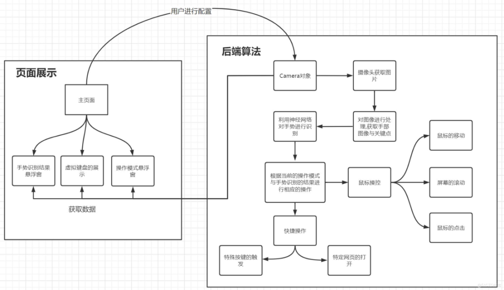

This project is mainly divided into two parts, which are front-end page display and back-end algorithm.

In the page display, the main page can set and adjust various numerical values such as quick gesture operations, mouse movement speed, wheel sensitivity, etc., and save these adjusted values in the project's configuration file. By clicking on the "Run Gesture Control Mouse" or "Shortcut Command Button" in the main page, the main program can start running, and at the same time, the gesture recognition result popup window and operation mode popup window will be opened to provide users with information about the current operation mode and gesture recognition.

In the backend algorithms, the camera object is the core of the entire system. Within the functions of the camera object, we first obtain the current raw image through the camera. Subsequently, by processing and recognizing the image, we capture key images and keypoints of the hand. These key images are then preprocessed before being fed into a neural network for gesture recognition. Based on the results from the neural network, we switch modes and perform corresponding actions. In the mouse control module, mouse movements, screen scrolling, and mouse clicks can be performed according to the gestures. If in quick-action mode, specific events can be triggered or specific web pages can be opened based on the gestures.

### System Module Implementation

#### Architecture Design of the Main Interface

The main interface design primarily includes three parts: the form section, the tool class section, and the style section.

##### Form Section

The main interface's form mainly consists of the following parts:

1. `MainWindow.py`

`MainWindow` is the main window of this program and the entry point for the entire application. It inherits from the `QWidget` class in `PySide`, primarily responsible for handling the layout of various child windows and managing calls to floating windows, cameras, etc.

1. `UserConfigWindow.py`

The `UserConfigWindow` is used for handling user shortcut gesture customization. The display box for the gestures uses the `QWidget` class, while the right side of the display box is implemented as a drop-down menu and text box for user settings and operations. The entire shortcut gesture section is placed within the scrollbar area, allowing easy implementation of adding or removing certain gesture functions in the future.

1. `SystemconfigWindow.py``SystemconfigWindow`

These are some basic attributes used to set up global mouse control. Currently, there are three main ones: Mouse sensitivity, Page scrolling rate, and Gesture recognition speed. They are displayed using a slider with a number box, which is convenient for users to adjust. They can be adjusted directly by dragging the slider or entering specific values.

1. `HelpWindow.py`

The `HelpWindow` is used to display basic help and instructions, primarily implemented using several different styles of `QLabel`.

#### Tools Class Section

For certain frequently used functionalities and components, it is convenient to encapsulate them into separate Python files for easy invocation. This also helps to clarify the code logic. The following are the main utility classes used.

1. `KeyBoardMap.py`

A mapping from the value of `Qt.Key_XXX` to its corresponding string name for keyboard keystrokes.

1. `MyLoading.py`

Used for displaying loading icons, the main principle is to play a GIF in progress through `QLabel`, and then use the outer `QLabel` to implement a mask layer.

1. `MyMessageBox.py`

This is used to implement a custom message popup, which displays a fade-in and automatically disappears information window at the top of the interface. It offers better effects than the built-in message popups provided by `PySide`. This class inherits from `QWidget`, achieving this effect by adjusting the position and transparency through the `timerEvent` method.

1. `PropertiesHandler.py`

For reading, creating, and saving configuration files. Mainly includes some basic file read/write operations.

1. `ThreadUtils.py`

Due to the complexity of terminating subthreads generated by the Threading class, `ThreadUtils` primarily provides operations for terminating threads. The implementation involves throwing an exception within the thread to terminate it.

1. `MyTabWidget.py`

It is a custom component that switches windows through tabs, inherited from the `QTabWidget` class in `PySide`, with additional features including animation during window switching. Since sub-windows in Qt cannot be directly adjusted for transparency, this animation primarily involves adjusting the transparency of the `QGraphicsOpacityEffect` view effect class of the window, using the `QPropertyAnimation` class to implement the animation.

##### Style section

This program implements a separation of concerns approach, where the interface layout and style design are handled separately. The GUI components are used for layout, while the styles are adjusted using QSS (Qt Style Sheets). Each GUI component has its corresponding QSS file, which is placed in the resources/qss folder. The QSS files primarily adjust properties such as background colors, fonts, and mouse hover effects for each GUI component. The style section also includes the design of some animation effects. For example, the animations for `MyMessagesBox` and `MyTabWidget`.

##### Collaboration with FloatWindow and Camera Objects

This process is mainly implemented in the `MainWindow` class. Within the `MainWindow` class, a `Camera` object, `Camera` thread object, `Keyboard` object, and various popup window objects are stored. The creation of popup windows, the creation of two camera objects, and the creation of the camera thread are controlled by two buttons: "Start Mouse Control" and "Start Quick Gesture Control." The hiding of popup windows, the destruction of camera objects, and the destruction of the camera thread are controlled by the "Stop" button.

#### Design of User-Configured Configuration Files

1. The configuration file is saved in the properties format, namely `settings.properties`, with a basic format of `key=value` for each line. 2. The reading and writing of the configuration file are implemented through the `PropertiesHandler`, which returns all keys and values read from the file. It also includes some checks for the integrity of the configuration file. If the configuration file is missing, it will automatically generate a new one. If there are missing or redundant key values in the configuration file, or if the value corresponding to certain keys is not in the correct format, the `PropertiesHandler` will make appropriate adjustments, such as deleting redundant key values, replacing missing or incorrectly configured items with default values, and re-writing the file.

#### Architecture Design and Implementation of the Floating Window

This project designs a base class `FLoatingWindow` for floating windows through `PySide2`, and based on this class, two derived classes `GestureFloatingWindow` and `ModelFloatingWindow` are created. These classes are used to display the corresponding skeleton diagrams of current gestures, as well as the current mode, events, and mouse's current position, respectively.

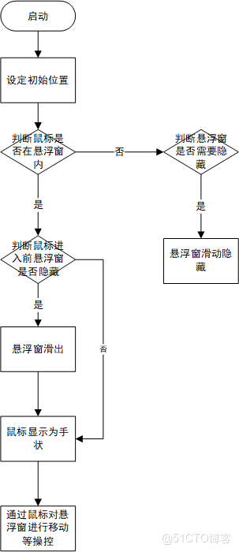

For the `FloatingWindow` base class, when initializing, it sets the window to be frameless by calling `self.setWindowFlags(Qt.FramelessWindowHint | Qt.WindowStaysOnTopHint | Qt.Tool)`, and sets the window to stay on top by calling `self.setWindowOpacity(0.5)`. It also sets the cursor to a pointing hand cursor when the mouse moves over the floating window by calling `self.setCursor(Qt.PointingHandCursor)`. At the beginning of the initialization, a class member variable `_hidden` is defined to mark whether the floating window is hidden or not. By calling `self.startTimer(100)`, the floating window refreshes every 100ms.

The popup window can be dragged and moved by clicking with the mouse. When the mouse enters or leaves the popup window, it determines whether the popup should slide out or hide through the hideOrShow function. If the popup is hidden before the mouse enters, it will slide out; if the mouse leaves and a coordinate check reveals that the popup has already touched the screen edge, it will hide. During the sliding of the popup, the startAnimation function is called to display the sliding effect, and different hiding methods are adopted in multi-screen scenarios to prevent the sliding box from crossing screens.

##### Displaying Camera Object Information in a Float Window

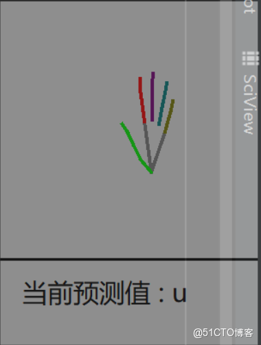

For the `GestureFloatingWindow` floating window, an `camera` object is passed in at initialization. The 21 joint positions of the palm in front of the screen are obtained from the `_points` array in the `camera` object. Then, the joints are connected in a specific order to draw the palm's skeleton diagram. The current gesture prediction value is displayed below the floating window. The floating window will refresh periodically to update the palm position and gesture prediction value.

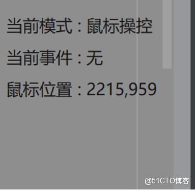

For the `ModelFloatingWindow` popup window, an `camera` object is also passed during initialization. The current mouse mode is obtained by accessing the `mouse_status` attribute of the `camera` object, and the current mouse position is obtained using the `pyautogui` library. The mode (such as mouse control, screen scrolling, quick operations), current event (such as mouse clicks, screen scrolling), and the absolute position of the current mouse on the screen are updated periodically.

#### Display of Virtual Keyboard

A virtual keyboard class `MyKeyboard` is drawn through `Pyside2`, and the `mouse_status` attribute in the `camera` object is periodically checked. When `mouse_status == 2`, it indicates that the current time is when a virtual keyboard needs to be drawn. The `keyboard_image` attribute in the `camera` object is converted into a `QImage` object in `Pyside2`.

Then, draw it onto the screen, setting the virtual keyboard to be borderless and always on top by calling `self.setWindowFlags(Qt.FramelessWindowHint | Qt.WindowStaysOnTopHint | Qt.Tool)`.

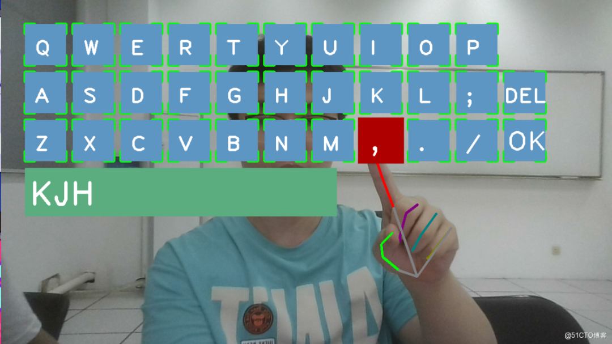

#### Camera Object Architecture and Design

#### Basic Architecture Design

The `camera` module implements the core functionalities of this program, including accessing the computer's camera, capturing each frame, processing the images to obtain their skeleton maps, extracting key regions from the skeleton maps, and feeding them into a trained neural network model to obtain predictions. Based on the obtained predictions, corresponding actions are executed.

This module includes a `Camera` class and a series of related auxiliary functions.

##### Flowchart

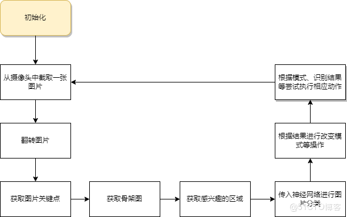

##### Camera Class Introduction

The `Camera` class stores many variables needed throughout the entire process of gesture recognition. These are mainly handled in the `__init__` function.

```
def __init__(self, model_path, class_names, mode):
# Read configuration file
    self.properties = PropertyHandler('settings.properties').get_properties()
# Loading the model
    self.model = dnn.readNetFromTensorflow(model_path)
# Set the category name
    self.class_names = class_names
# Set up the camera
    self.capture = cv.VideoCapture(0)
    self.capture.set(cv.CAP_PROP_FRAME_WIDTH, 1280)
    self.capture.set(cv.CAP_PROP_FRAME_HEIGHT, 720)
# Set Gesture Recognition
    self.hands = mp.solutions.hands.Hands(False, min_detection_confidence=0.3, min_tracking_confidence=0.3)
# Key Coordinate Points (Original)
    self.points = []
# Set Mode
    self.mode = mode
    self.mouse_status = MOUSE_MOVING
# Record the time when the state changes
    self.change_begin_time = 0
# The duration of the gesture needs to be maintained to change the state.
    self.keep_time = self.properties['gesture_recognition_speed'] / 50
# Action Object
    self.command_map = {}
    self.mouse_moving = MouseMoving.MouseMoving()
    self.scroll_screen = ScrollScreen.ScrollScreen()
    self.string_action = StringAction.StringAction(properties=self.properties)
# Predicted value
    self.predicted_value = None
# Saved images
    self.origin_image = None
# Virtual Keyboard
    self.virtual_keyboard = None
    self.keyboard_image = None
```

#### Relevant function introduction

Functions in the Camera class

The following function requires the use or update of variables in the `Camera` class.

###### Get a frame of an image

The function prototype is `get_frame_image(self)`, and it finally returns the flipped image of the current frame.

Use the `VideoCapture` function from OpenCV to call the computer's camera, and use the `flip` function to mirror flip operations, making the hand movement in the picture more intuitive. Then set the image variable in the class, which is convenient for other functions to use.

###### Input image to get keypoints

The function prototype is `get_critical_hands_points(self, image)`, which returns the key points in the image.

Use the open-source framework of Google's `mediapipe` to process images, obtain keypoints in the image, and update the points variable in the class. This makes it convenient for other functions to determine whether the execution can be performed and reduces the overhead of repeatedly processing large amounts of images.

### Using Neural Networks for Classification of Processed Images

The function prototype is `change_mouse_status(self, pre_class_id, class_id)`, which returns the classification result of the image.

Pass an image and perform prediction operations using the model loaded during initialization in the `Camera` class. Based on the maximum index number, obtain the predefined category name.

As shown below

```
def categorize_image(self, image):
# Adjust image size
    image_resized = cv.resize(image, (100, 100))
# Convert images to blob format
    image_blob = dnn.blobFromImage(image_resized,
                                   scalefactor=1.0 / 225.,
                                   size=(100, 100),
                                   mean=(0, 0, 0),
                                   swapRB=False,
                                   crop=False)
# Use the loaded neural network model.
    net = self.model
    net.setInput(image_blob)
# Obtain the prediction results
    result = net.forward()
    result = result.flatten()
# Obtain the index corresponding to the prediction result
    class_id = np.argmax(result)
    return self.class_names[class_id]
```

### Encapsulating all gesture recognition operations

Encapsulate all basic operations to facilitate calling.

```
# Full Operations of Gesture Recognition, Including Key Point Acquisition and Interest Area Acquisition
def gesture_recognition(self, image):
    critical_points = self.get_critical_hands_points(image)
    if len(critical_points):
# Obtain a black background image
        black_image = np.zeros(image.shape, dtype=np.uint8)
# Identify the skeleton diagram
        bone_image = get_bone_image(black_image, critical_points)
# Extracting the Region of Interest (ROI) for Hand
        roi_image = get_roi(bone_image, critical_points)
# Send into neural network for recognition
        class_id = self.categorize_image(roi_image)
# Determine whether to switch the pattern based on the recognition results.
        self.change_mouse_status(self.predicted_value, class_id)
        self.predicted_value = class_id
```

###### Try to change the control mode

The function prototype is `change_mouse_status(self, pre_class_id, class_id)`

Set a switching time. If the identification result this time is the same as the last one and keeps the set time, then try to switch to the control mode.

### Attempt to perform an action

The function prototype is `execute_action(self, points)`

Determine the current mode, then call different actions from the Action module based on the current mode, gesture recognition results, and key points corresponding to each joint.

###### Other auxiliary functions

The following functions are auxiliary functions, defined outside the `Camera` class for convenience in calling by other modules.

###### Obtaining Interested Regions (ROI)

The function prototype is `get_roi(image, points)`

Based on the skeleton diagram and obtained key points, obtain the interested area.

Locate the coordinates corresponding to the root of the middle finger, which can be considered as the center point of the hand. By expanding a fixed number of pixels up, down, left, and right from this point, the critical area is captured.

```
# Obtain the interested area based on the skeleton diagram and obtained key points
def get_roi(image, points):
# Get the dimensions of an image
    image_height, image_width = image.shape[0], image.shape[1]
# Get the center point (root of the middle finger) coordinates
    center_x, center_y = points[9]
    center_x *= image_width
    center_y *= image_height
    center_x = int(center_x)
    center_y = int(center_y)
# Obtaining boundaries for up, down, left, and right
    x_left, x_right = int(max(center_x - 200, 0)), int(min(center_x + 200, image_width - 1))
    y_top, y_bottom = int(max(center_y - 200, 0)), int(min(center_y + 200, image_height - 1))
# Extract images
    pic = image[y_top:y_bottom, x_left:x_right]
    return pic
```

###### Draw the Skeleton Diagram

The function prototype is `get_bone_image(image, points)`

Map the points to the real image positions according to the input keypoints, and draw a skeleton map using `OpenCV` for later input into neural networks for recognition.

Connect the joints of the fingers with different colored lines for easy differentiation of five different fingers and the palm area.

#### Quick Instructions Architecture and Design

#### Basic Architecture Design

To facilitate the execution of all shortcut commands, we have designed the `BaseAction` class as the base class for all `Action` classes.

Shortcut Instructions inherit the `BaseAction` class and design the `StringAction` class, mapping recognition results, reading the configuration file to obtain the corresponding string for the operation, and then converting each string into the corresponding instruction.

The instructions include actions such as pressing the corresponding button or opening a specified webpage, etc. The parameters corresponding to these actions can be modified through the front-end interface by modifying the configuration file.

#### Related Functions Introduction

### Initialization

The initialization process includes mapping the results of gesture recognition to keys in a configuration file.

```
def __init__(self, properties):
    super().__init__()
# Map the recognition results
    self.cmd_dict = {
        'l': 'left',
        'r': 'right',
        'u': 'up',
        '0': 'zero'
    }
# Configuration File
    self.properties = properties
# Set the time interval for each gesture recognition
    self._STOP_DURATION = 2
# Current instruction
    self.command = None
```

###### Execute action

Read the keys and web URLs from the configuration file, and use `pyautogui` and `webbrowser` libraries to perform corresponding actions.

At the same time, in order to avoid continuous recognition of the same gesture and continuously executing the same command, an idle period is set for each action after executing an instruction. Only after a certain period has passed since the last action can the next action be executed.

```
def action(self):
    if self._can_action:
# Retrieve action names
        action_name = self.properties[self.command + '_action']
        if action_name == 'press_key':
# Press the button
            pag.press(self.properties[self.command + '_action_key'])
        elif action_name == 'open_url':
# Open a webpage
            webbrowser.open(self.properties[self.command + '_action_url'], new=0, autoraise=True)
# Set to inoperable
        self._can_action = False
        self._stop_time = time.time()
    else:
        if time.time() - self._stop_time > self._STOP_DURATION:
# Unfreeze Operation
            self._can_action = True
```

#### Mouse-Controlled Architecture and Design

#### Mouse Movement Module

The module for mouse movement is the `MouseMoving` class, which inherits from `BaseAction` and overrides the `action` method. In the `action` method, it obtains the coordinates of the hand keypoints passed by the `camera` object and calculates the relative distance of this finger movement.

Then determine whether the current is within the non-responsive period for mouse control. If not, check if the relative coordinates of movement are less than a specific value. If so, attempt to perform a click operation. Otherwise, start a new thread to execute the mouse movement operation. If the current is within the non-responsive period for mouse control, detect the time difference between when the mouse enters the non-responsive period and the current time. Check if this time difference exceeds our specified time limit. If it does, release the non-responsive state of the mouse control object.

```
# Determine if the period is not active
        if self._can_action:
# Can we try clicking?
            if abs(x_m) < 15 and abs(y_m) < 15:
                self.try_click(points)
            else:
# Start a new thread, move the mouse.
                _thread.start_new_thread(self.move, (x_m, y_m,points))
                # self.move(x_m, y_m, points)
        else:
# Determine if the non-disclosure period can be lifted
            if time.time() - self._stop_time > self._STOP_DURATION:
                self._can_action = True
                self._stop_time = 0
# Update the last mouse position
        self._last_x = x_r
        self._last_y = y_r
```

In the function for moving the mouse, firstly, the relative distance of the finger moving in the x-axis and y-axis direction is obtained by the parameter. If the relative distance of the movement is greater than a certain value, we consider this operation as a fast move, which means the mouse will move from the top to the bottom of the screen or from the left to the right. The operator's hand will make a larger range of movement. To prevent the operator's hand from changing its relative position significantly, the operator is allowed to return the fingers back to their original position after performing the action. There is an 0.5-second non-responsive period after the quick operation, during which the operator's hand movements do not affect the mouse's movement. This allows the operator time to reposition their hand back to a comfortable distance. Additionally, the distance moved is magnified accordingly.

```
if abs(x_m) > 370 or abs(y_m) > 270:
# Quick movement
            x_m = int(x_m * 4)
            y_m = int(y_m * 3.5)
# Adjustment of Mouse Sensitivity
            x_m = self.mouse_sensitivity*x_m
            y_m = self.mouse_sensitivity*y_m
            self._stop_time = time.time()
            self._can_action = False
            pag.moveRel(x_m, y_m, duration=0.25)
```

Mouse Control Module Process Diagram

##### Screen scrolling module

The module for mouse movement is the `ScrollScreen` class, which inherits from `BaseAction` and overrides the `action` method. In the `action` method, it obtains the coordinates of the hand keypoints passed by the `camera` object.

The flow of its `action` function is similar to the `action` function of the mouse move module. After obtaining the coordinates of the hand, it first checks whether it is within the non-allowable period.

If not, determine whether the current vertical coordinate of hand movement is greater than a certain threshold. If it is, perform corresponding screen scrolling operations based on the direction of hand movement. After each screen scroll operation, set a certain non-responsive period to avoid excessive frequency of operations that may affect user experience.

```
def action(self, points):
        if len(points) == 0:
            return
# Current finger position
        y_r = points[8][1] * 1600
        if self._can_action:
            if self._last_y == 0:
                self._last_y = y_r
            else:
# Relative coordinates of movement
                y_m = y_r - self._last_y
                if abs(y_m) > 500:
                    pag.scroll(int(y_m * 1.5 * self.scroll_speed))
                    self._stop_time = time.time()
                    self._can_action = False
                self._last_y = y_r
        else:
            if time.time() - self._stop_time > self._STOP_DURATION:
                self._can_action = True
                self._stop_time = 0
```

#### Architecture and Design of Virtual Keyboard

The virtual keyboard is implemented in the `VirtualKeyboard` class, which inherits from the `BasetAction` class and overrides the `action` method.

In the `action`, first obtain the coordinates of hand keypoints transmitted by the `camera` object and the raw image captured by the current frame camera.

Then, in the `DrawAll` function, all keys on the keyboard are first drawn on the original image captured by the camera.

```
# Drawing a keyboard
    def draw_all(self, image, button_list):
# Draw all buttons
        for button in button_list:
            x, y = button.pos
            w, h = button.size
            cvzone.cornerRect(image, (button.pos[0], button.pos[1], button.size[0], button.size[1]),
                              20, rt=0)
            cv2.rectangle(image, button.pos, (x + w, y + h), (195, 150, 94), cv2.FILLED)
# Draw DEL key
            if button.text == 'DEL':
                cv2.putText(image, button.text, (x, y + 65),
                            cv2.FONT_HERSHEY_PLAIN, 3, (255, 255, 255), 4)
# Drawing OK key
            elif button.text == 'OK':
                cv2.putText(image, button.text, (x + 5, y + 65),
                            cv2.FONT_HERSHEY_PLAIN, 4, (255, 255, 255), 4)
            else:
# Drawing other buttons
                cv2.putText(image, button.text, (x + 20, y + 65),
                            cv2.FONT_HERSHEY_PLAIN, 3, (255, 255, 255), 4)
# Draw the input box below
        cv2.rectangle(image, (50, 350), (700, 450), (127, 172, 91), cv2.FILLED)
        cv2.putText(image, self.final_text, (60, 430),
                    cv2.FONT_HERSHEY_PLAIN, 5, (255, 255, 255), 5)
        return image
```

Then, check if the coordinates of the index finger's tip and each key's coordinates coincide. If they do, change the color of that key to indicate a dot. Subsequently, detect the coordinates of the index finger's tip and the middle finger's tip. If their coordinates coincide, it is considered as a single click operation. Enter the keyboard's text values into the input box below and store them. When the 'OK' button is pressed, all the entered text values will be inputted into the corresponding text boxes. Additionally, change the current control mode to mouse control.

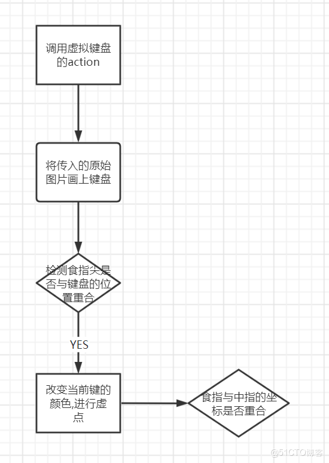

#### Training Process of Neural Network Model

##### Collection and Preprocessing of Dataset

Dataset Content: The dataset used in this project is a specific gesture dataset. Due to the project requirements, all datasets were ultimately captured using images of gestures under different scenarios. The dataset for this project is divided into two categories: mouse control datasets and shortcut key control datasets. Each gesture was photographed in 200 different directions and angles, with each set of photos stored in a subfolder within the `dataSet` folder, with the name of the parent folder being the label of the photo.

**Mouse Control Dataset:**

In this dataset, gesture `5` is used to switch between mouse control mode and screen scrolling mode. In the mouse control mode, the camera controls the mouse movement by detecting the position of the index finger's tip, and performs mouse click operations by detecting the distance between the index finger's tip and the middle finger's tip.

After maintaining the '5' gesture for a period, switch between mouse control mode and screen scrolling mode. In the screen scrolling mode, the '1' gesture is used to control the scrolling function in the screen scrolling mode. Moving your finger up will scroll the screen downwards, while moving it down will scroll the screen upwards; the '2' gesture is used to summon a virtual keyboard. The virtual keyboard is displayed through the `cvzone` library, with the position of different keys being switched by detecting the position of the index finger tip. The pressing of the keyboard is achieved by detecting the distance between the index finger tip and the middle finger tip. If the mouse cursor can be inputted before entering the virtual keyboard, after clicking the OK key on the virtual keyboard, the content of the key pressed in the keyboard will be inputted into the input box.

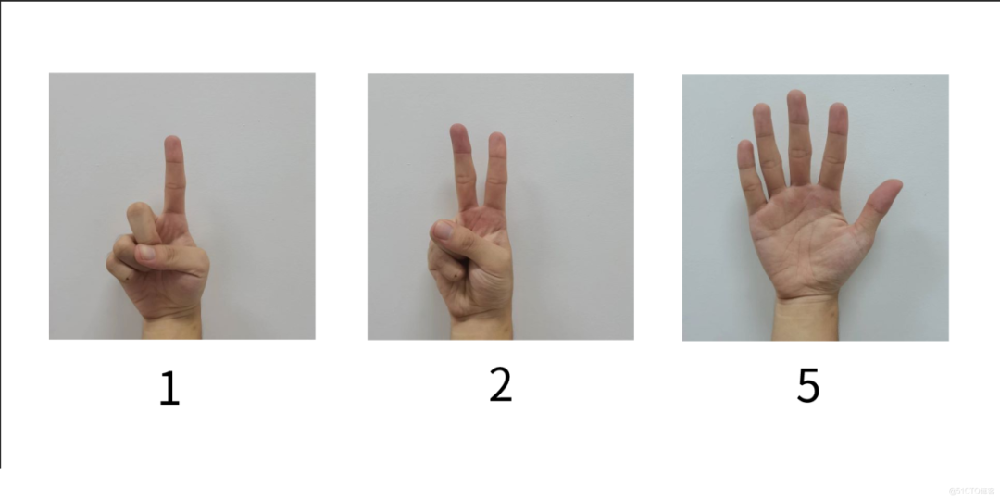

**Shortcut Control of Dataset:**

In this dataset, different gestures are assigned with different shortcut keys or specific web page operations. Users can also customize these gesture-related shortcuts on the main interface, allowing any gesture to correspond to a specific key or open a webpage operation. Initially, the up gesture is set to open a certain website, and users can also modify the website address through the main interface. The l and r gestures are initially set to the LEFT and RIGHT keys of the keyboard, respectively.

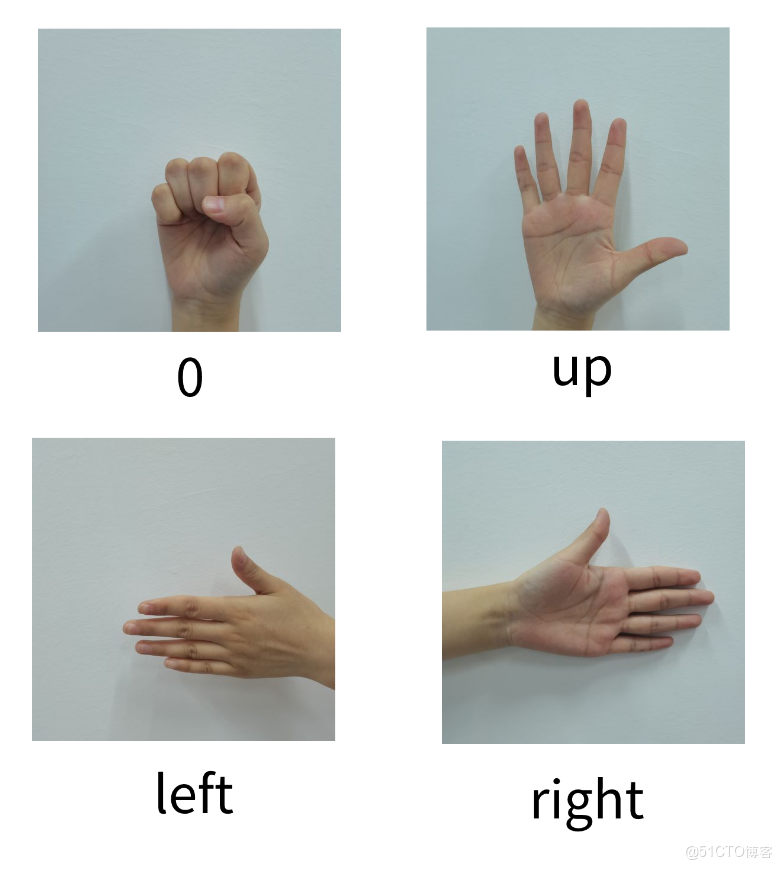

##### Training Process of CNN Model

After the dataset has been photographed, it is necessary to perform preprocessing operations on the dataset.

-

Firstly, the images of the data need to be processed with compression using the `resize` function from `opencv`.

```
image = cv2.resize(image, (100, 100))
```

Convert the image to a size of 100*100 for preparation for later training.

-

Then, using the open-source framework `mediapipe` from Google, we can identify hand gestures in the dataset and obtain the coordinate data of key points. Subsequently, we use this crucial data to draw a skeleton diagram of the hand, which is then drawn on a black image to achieve recognition and labeling of key positions in the hand.

```
[#Retrieve the hand identifier]
mp_hands = mp.solutions.hands
hands = mp_hands.Hands(True, 1, min_detection_confidence=0.3, min_tracking_confidence=0.3)
[#Processing Images]
results = hands.process(image)
```

-

Then, take 1/6 of the processed images as the test set for data.

After preprocessing the dataset, the next step is to train the gesture recognition model. This involves reading the images from the dataset's root directory using pathlib. Iterate through each subdirectory in the dataset's root directory to obtain the paths of each image and use the names of the subdirectories as labels for the data.

```
def read_data(path):
    path_root = pathlib.Path(path)
    image_paths = list(path_root.glob('*/*'))
# Traverse subdirectories
    image_paths = [str(path) for path in image_paths]
    random.shuffle(image_paths)
    image_count = len(image_paths)
# Retrieve label
    label_names = sorted(item.name for item in path_root.glob('*/') if item.is_dir())
    label_name_index = dict((name, index) for index, name in enumerate(label_names))
# Get image path
    image_labels = [label_name_index[pathlib.Path(path).parent.name] for path in image_paths]
    return image_paths,image_labe
```

Subsequently, the data and labels are integrated together using the `tf.data.Dataset.from_tensor_slices` function from `tensorflow`, and then the image data is obtained through the image path to create a dataset needed for training in `tensorflow`.

```
[#Normalize the image]
def preprocess_image(image):
    image = tf.image.decode_jpeg(image, channels=3)
    image = tf.image.resize(image, [100, 100])
    # normalize to [0,1] range
    image /= 255.0  
    return image
# Reading an image
def load_and_preprocess_image(path,label):
    image = tf.io.read_file(path)
    return preprocess_image(image),label
[#Creating Dataset]
def creat_dataset(image_paths,image_labels,bitch_size):
    db = tf.data.Dataset.from_tensor_slices((image_paths, image_labels)) 
    dataset = db.map(load_and_preprocess_image).batch(bitch_size)  
    return dataset
```

Next, we create the structure of our CNN network. Our network consists of three convolutional layers, two pooling layers, two fully connected layers, and an output layer. The first convolutional layer has 32 convolutional kernels with a size of 5×5. The second and third convolutional layers each have 64 convolutional kernels with a size of 3×3. Both use ReLU as the activation function. In the fully connected layers, the first layer has 512 neurons, and the output layer's neuron elements are the same as the sample categories in the dataset.

```
network = keras.Sequential([
# 32 Convolutional Layers with 32 Kernels
            keras.layers.Conv2D(
            32,kernel_size[5,5],padding="same",activation=tf.nn.relu),
# 2 * 2 max pooling layer
            keras.layers.MaxPool2D(
            pool_size=[2, 2], strides=2, padding='same'),
# 64 Convolutional Layers with 64 Kernels
            keras.layers.Conv2D(
            64,kernel_size=[3,3],padding="same",activation=tf.nn.relu),
# 2 * 2 max pooling layer
            keras.layers.MaxPool2D(
     		pool_size=[2, 2], strides=2, padding='same'),
# 64 Convolutional Layers with 64 Kernels
            keras.layers.Conv2D(
            64,kernel_size=[3,3],padding="same",activation=tf.nn.relu),
            keras.layers.Flatten(),
# Fully Connected Layer
            keras.layers.Dense(512,activation='relu'),
# Randomly Discarding Neurons
            keras.layers.Dropout(0.5),
# Fully Connected Layer
            keras.layers.Dense(128,activation='relu'),
            keras.layers.Dense(3)])
  network.build(input_shape=(None,100)
```

After training, save the model as a pb format file.

Furthermore, to expedite the speed of model training, we utilize Google's Kaggle computing platform for model training, which can significantly reduce the time required for training.

### System Testing

Tests are conducted for each important module, as well as after the full implementation of all program functions. The content of the tests is as follows.

-

Test whether the window display in `mainWindow` class is normal, whether the font display ratio is correct, and whether each button corresponds to its function.

-

Test whether the floating windows display correctly, whether the hand skeleton diagram can be displayed normally, and whether the current mouse operation mode can be displayed.

-

Test whether the reading and saving of test configuration files are normal. Change the dropdown box in the frontend and save, then check if the corresponding items can be found in the configuration file.

-

Test the functionality of the neural network model.

-

Test the mouse control (including mouse movement, mouse click, scrolling screen, etc.) to ensure that it functions normally and whether adjustments such as sensitivity can be achieved are tested.

-

Test the quick command feature to ensure it functions correctly, whether you can press the keystored in the configuration file, and whether you can open the specified webpage.

-

Test the installation program to ensure it is running correctly and can be uninstalled normally.

-

Test the functionality of the installed program.

### System Installation Manual

#### Download and Installation Package

We have created an installation program for our software. After downloading the installation program, double-clicking the program will initiate the installation process. Please note that during the installation, do not install the software on the C drive, which is the system partition. This may cause conflicts with certain operational permissions. Once installed, a shortcut to our software icon will appear on the desktop. Double-clicking this shortcut will allow the software to run normally.

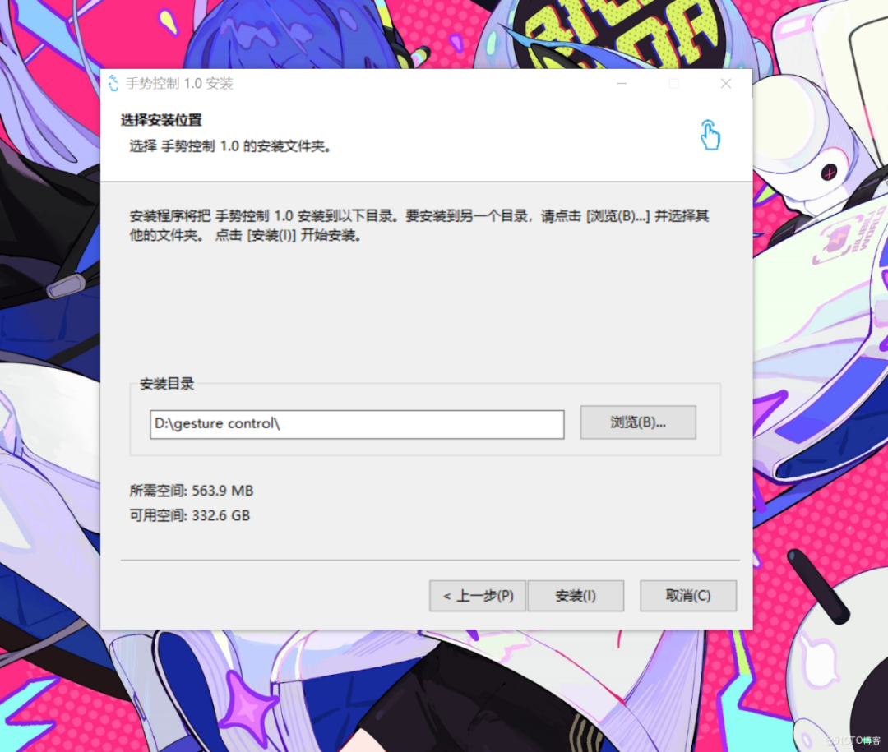

#### Source code level execution

If you need to run our program from the source code level, use PyCharm to open the directory `gesture_control_app` in project mode, then download the dependencies specified in `requirements.txt`, and then run `mainWindow.py` to execute our main program.

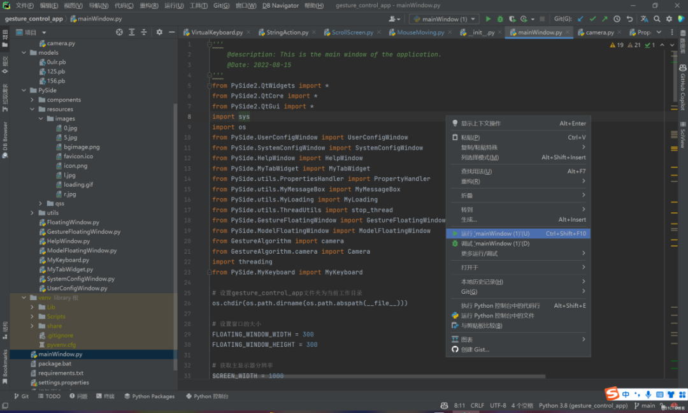

### System User Manual

1. **Introduction**

This program primarily implements the functionality of operating a computer using gestures. Users can use specific gestures to control the mouse or perform specific shortcut actions, which are convenient for users in certain situations such as flipping through slides.

1. **Usage Method**

This program mainly has two modes: mouse control mode and shortcut gesture mode.
(1) **Mouse Control Mode**

-

Click "Start Mouse Control" to enter the mouse control mode. By extending your fingers into a five-pointed star, you can switch between the moving state and the up-and-down sliding state of the mouse.

-

When the mouse is in motion, extending the index finger and sliding it in a certain direction can control the mouse to move in that direction.

-

The faster the finger swipes, the greater the extent of mouse movement.

-

Mouse sensitivity can be adjusted in system settings.

-

With the middle finger lightly touching the index finger, mouse clicks can be performed.

-

The index finger and middle finger form a "V" shape, which can open the floating keyboard.

-

When in the up-down scrolling state, use the index finger to slide up or down to achieve page scrolling.

-

The page scrolling speed can be adjusted in the system settings.

-

Click the "Stop" button or press the F1 key to exit the mouse control mode.

(2) **Quick Gesture Mode**

-

Click "Start Shortcut Control" to enter the shortcut gesture mode.

-

Shortcut gestures can be viewed and set in the user-customized interface.

-

Shortcut gestures can be configured to function as both shortcut keys and open URLs.

-

Click the "Stop" button or press the F1 key to exit the shortcut gesture mode.

(3) **Setting Instructions**

-

Click "System Settings" to enter the system settings interface.

-

The system settings interface currently features three options, allowing for adjustment of numerical values by dragging sliders or inputting specific numbers into the numeric input boxes and pressing Enter.

-

Click "User Customization" to enter the User Customization interface.

-

Clicking on the dropdown menu allows you to change the current gesture. If the current action is to open a webpage, enter the URL you wish to open in the text box. If the current action is a shortcut, click on the text box and press the key you want to set as your shortcut.

-

All settings are completed only after clicking "Save" to save the current changes locally.

-

Only after the save is completed can the changes made by clicking "Start Mouse Control" or "Start Quick Gesture Control" be effective. If you are in a finger control mode during modification, you need to first click to stop before re-clicking any start button to make the changes effective.


## Payment

Here is a pay link on Stripe ( https://buy.stripe.com/3cs8yP7sY87d0vu9AB ). Please contact me lonlonago@foxmail.com after funding $89, and I will send you a complete data files , thank you!


